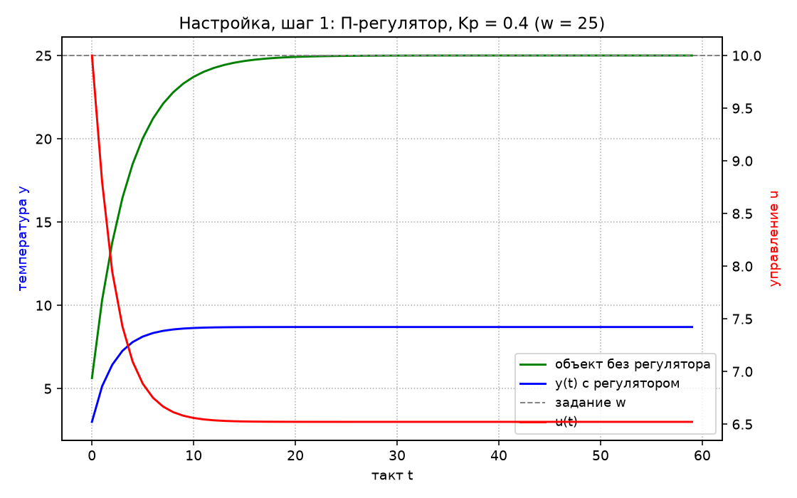
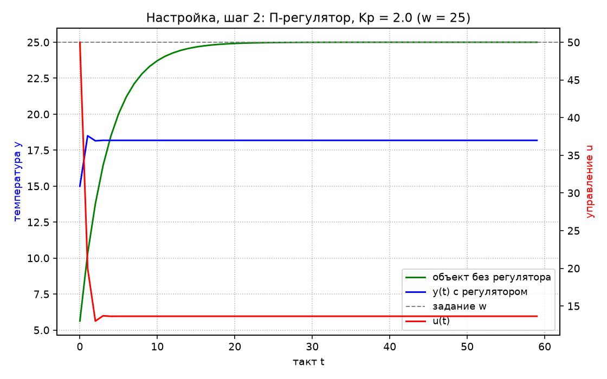
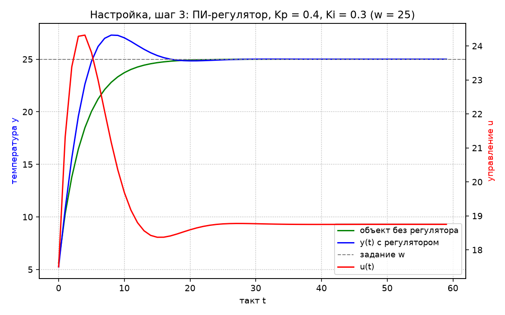
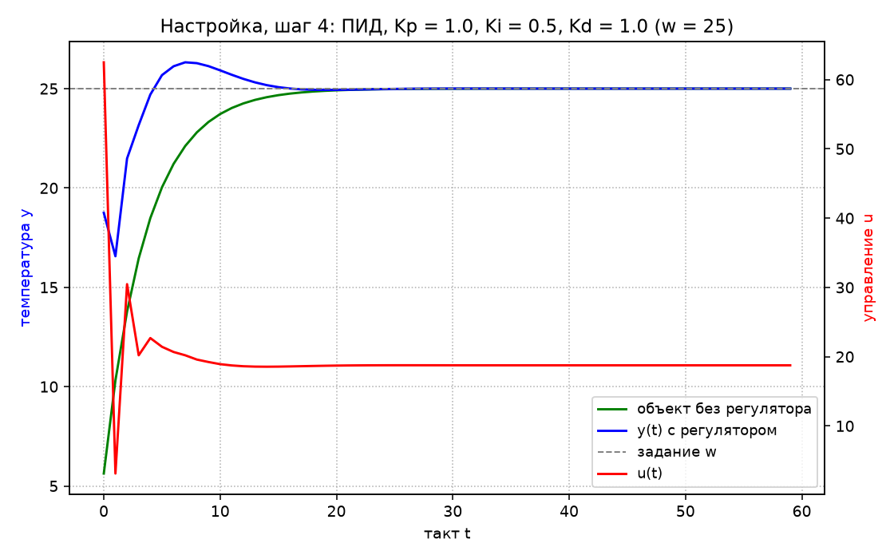
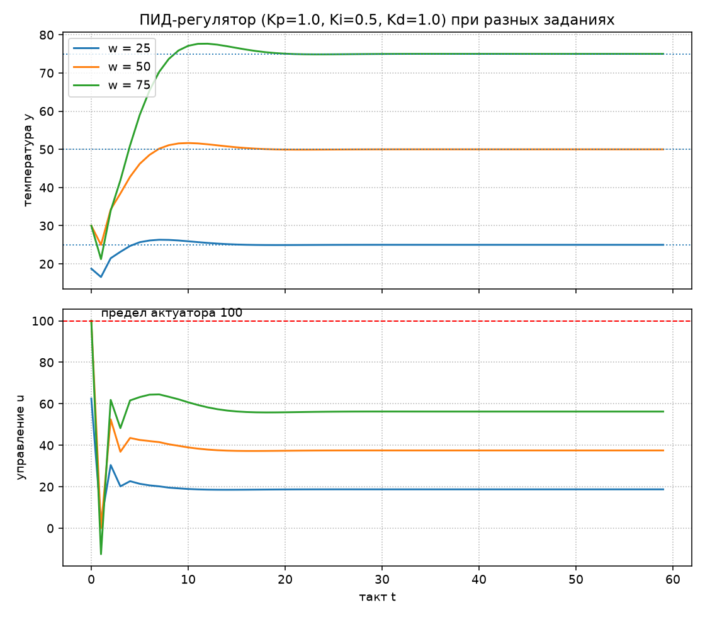
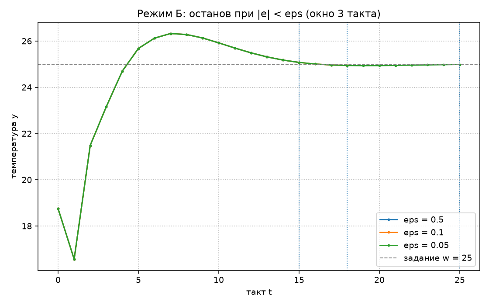
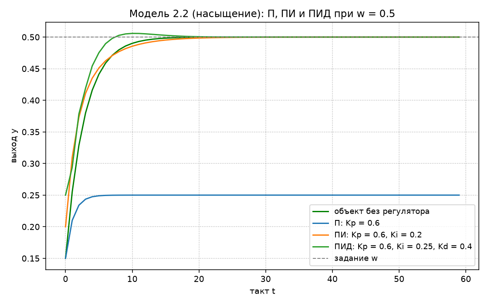
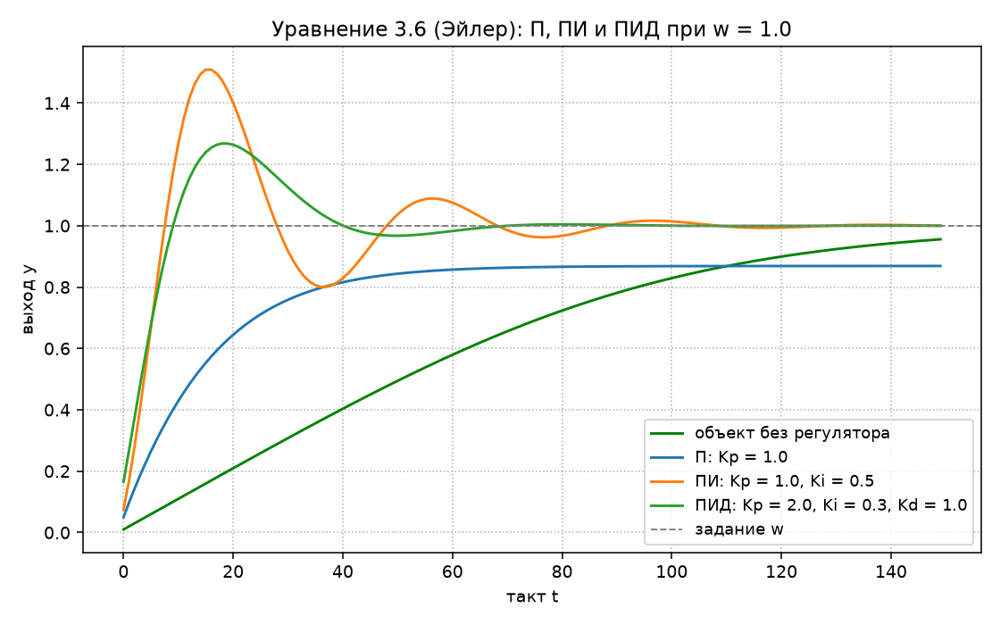

Министерство образования Республики Беларусь

Учреждение образования

“Брестский Государственный технический университет”

Кафедра ИИТ

      

Лабораторная работа №3

По дисциплине “Теория и моделирование автоматического управления”

Тема: “ПИД-регулирование и автоматическая документация”

     

Выполнил:

Студент 3 курса

Группы АС-68

Хотько И.А.

Проверил:

Дворанинович Д. А.

     

Брест 2026

## Вариант 18

- Линейная модель: **Model 1.8** (обобщённая авторегрессионная)
- Нелинейная модель: **Model 2.2** (насыщение исполнительного механизма)
- Дифференциальное уравнение: **Model 3.6** (кубический рост, метод Эйлера)

## Цель работы

Реализовать систему автоматического управления с дискретным ПИД-регулятором
для объектов из ЛР №1: замкнутый контур регулирования «температуры»,
гибкие режимы симуляции (фиксированное число тактов и до установившегося
режима), табличное представление и графическая визуализация результатов,
модульные тесты (Google Test), документирование кода (Doxygen) с
автоматической публикацией на GitHub Pages.

## Теоретическая часть

Непрерывный закон ПИД-регулирования:

$$u(t) = K_p e(t) + K_i \int_0^t e(\tau) d\tau + K_d \frac{de(t)}{dt}, \qquad e(t) = g(t) - y(t)$$

В программе используется дискретная **инкрементная (рекуррентная) форма**
с шагом квантования $\Delta t = 1$ такт:

$$\Delta u_{\tau} = K_p (e_{\tau} - e_{\tau-1}) + K_i e_{\tau} \Delta t + \frac{K_d}{\Delta t} (e_{\tau} - 2 e_{\tau-1} + e_{\tau-2})$$

$$u_{\tau} = u_{\tau-1} + \Delta u_{\tau}$$

Такая форма не требует хранить всю историю ошибки: достаточно $u_{\tau-1}$,
$e_{\tau}$, $e_{\tau-1}$, $e_{\tau-2}$. Связь с коэффициентами $q_0, q_1, q_2$
из методички: $q_0 = K_p + K_i \Delta t + K_d / \Delta t$, $q_1 = -K_p - 2 K_d / \Delta t$, $q_2 = K_d / \Delta t$.

**Ограничение актуатора (anti-windup).** Управляющее воздействие ограничено
пределами исполнительного устройства $[u_{min}, u_{max}]$. Так как в
инкрементной форме история хранит уже ограниченное значение $u_{\tau-1}$,
«раскрутка» интегральной суммы во время насыщения не накапливается: после
снятия насыщения управление сразу отслеживает ошибку (проверено тестом
`PidTest.IntegralDoesNotWindUp`).

## Структура программы

| Файл | Назначение |
| :-- | :-- |
| `src/model.hpp` | абстрактный объект управления (интерфейс `step/reset/get_y`) |
| `src/linear_model.*` | модель 1.8: $y_{\tau+1} = a_1 y_\tau + a_2 y_{\tau-1} + b_1 u_\tau + b_2 u_{\tau-1}$ |
| `src/nonlinear_model.*` | модель 2.2: $y_{\tau+1} = a y_\tau + b \cdot sat(u_\tau)$, sat — насыщение $\pm 0.5$ |
| `src/diff_model.*` | уравнение 3.6: $\dot y = a y^3 + b u$, метод Эйлера с шагом 0.1 |
| `src/pid.*` | инкрементный ПИД-регулятор с ограничением актуатора |
| `src/control_system.*` | замкнутый контур, режимы А/Б, открытый контур |
| `src/csv_writer.*` | экспорт траекторий в CSV (`tau,w,e,u,y`) |
| `src/main.cpp` | интерактивный режим (меню объекта, ввод параметров) и `--demo` |

**Переключение объекта управления** — выбором модели в меню программы
(классы наследуют общий интерфейс `Model`). **Режимы симуляции**:

- **Режим А** — фиксированное число тактов $n$ (`run_fixed_steps`);
- **Режим Б** — до установившегося режима: пока $|e_\tau| < \epsilon$
  3 такта подряд (`run_until_steady`); ограничение `max_steps` защищает
  от зацикливания при расходящемся процессе.

Результаты выводятся таблицей в консоль и экспортируются в CSV;
`task03_as06818_app --demo` воспроизводит все сценарии отчёта,
графики строятся скриптом `plot.py` (Python/Matplotlib).

## Настройка регулятора на модели 1.8 (метод последовательного подбора)

Статический коэффициент объекта при $a_1=0.5, a_2=0.2, b_1=0.3, b_2=0.1$:

$$k = \frac{b_1 + b_2}{1 - a_1 - a_2} = \frac{0.4}{0.3} = \frac{4}{3}, \qquad
e_{ss} = \frac{w}{1 + K_p k}$$

Задание во всех опытах $w = 25$ (условная температура).

**Шаг 1. П-регулятор, $K_p = 0.4$.** Ошибка убывает до установившейся
$e_{ss} = 25 / (1 + 0.4 \cdot 4/3) = 16.30$ — эксперимент даёт 16.304
(`task03_tune1_p.csv`): П-регулятор оставляет статическую ошибку.

**Шаг 2. Увеличение $K_p$ до 2.0.** Статическая ошибка падает до
$25/(1+2 \cdot 4/3) = 6.82$ (эксперимент 6.818), но не исчезает. Дальнейший
рост $K_p$ бесперспективен: при $K_p = 4$ контур входит в колебания
(перерегулирование ~20%), при $K_p \approx 6.5$ теряет устойчивость.

**Шаг 3. ПИ-регулятор, $K_p = 0.4$, $K_i = 0.3$.** Интегральная часть
устраняет статическую ошибку ($y_{end} = 25.000$), но процесс выходит на
задание с перерегулированием $\sigma = 9.2\%$ и колебаниями.

**Шаг 4. ПИД-регулятор, $K_p = 1.0$, $K_i = 0.5$, $K_d = 1.0$.** Подбором
найден компромисс: дифференциальная часть демпфирует колебания, рост $K_p$
ускоряет процесс. Итог: $\sigma = 5.3\%$, время регулирования (труба 2%)
12 тактов. Большие $K_d$ (от ~2 при данном $K_i$) дестабилизируют контур —
производная усиливает шум ошибки на каждом такте.

| Шаг | Регулятор | $y_{end}$ | $\sigma$, % | $t_{рег}$ (2%), такт |
| :-- | :-- | --: | --: | --: |
| 1 | П, $K_p=0.4$ | 8.696 | — | не устанавливается |
| 2 | П, $K_p=2.0$ | 18.182 | — | не устанавливается |
| 3 | ПИ, $0.4/0.3/0$ | 25.000 | 9.2 | 15 |
| 4 | ПИД, $1.0/0.5/1.0$ | 25.000 | 5.3 | 12 |

Фрагмент таблицы процесса (Режим А, `task03_tune4_pid.csv`):

| $\tau$ | $w$ | $e_\tau$ | $u_\tau$ | $y_\tau$ |
| --: | --: | --: | --: | --: |
| 0 | 25 | 25.000 | 62.500 | 18.750 |
| 1 | 25 | 6.250 | 3.125 | 16.563 |
| 2 | 25 | 8.438 | 30.469 | 21.484 |
| 3 | 25 | 3.516 | 20.195 | 23.160 |
| 4 | 25 | 1.840 | 22.686 | 24.702 |
| 5 | 25 | 0.298 | 21.426 | 25.680 |
| ... | ... | ... | ... | ... |
| 59 | 25 | 0.000 | 18.750 | 25.000 |

Зелёная кривая на графиках — объект без регулятора при постоянном
управлении $u = 18.75$, при котором установившееся значение то же
($y_\infty = k \cdot u = 25$): переходный процесс замкнутого контура
быстрее и компенсирует возмущения.

## Разные задаваемые температуры

Итоговые настройки при $w = 25, 50, 75$ (предел актуатора $\pm 100$):

| $w$ | $\sigma$, % | $t_{рег}$ (2%), такт | $u_{end}$ |
| --: | --: | --: | --: |
| 25 | 5.3 | 12 | 18.75 |
| 50 | 3.3 | 14 | 37.50 |
| 75 | 3.6 | 16 | 56.25 |

При $w = 50$ и $w = 75$ регулятор на первых тактах упирается в предел
актуатора (на графике $u(t)$ — выход на красную линию 100). Благодаря
ограничению в инкрементной форме перерегулирование при этом не растёт
(3.3–3.6%), хотя начальная ошибка втрое больше.

## Режим Б: моделирование до установившегося режима

Симуляция завершается, когда $|e_\tau| < \epsilon$ 3 такта подряд.

| $w$ | $\epsilon$ | Тактов до останова | $|e|$ в конце |
| --: | --: | --: | --: |
| 25 | 0.5 | 16 | 0.176 |
| 25 | 0.1 | 19 | 0.036 |
| 25 | 0.05 | 26 | 0.023 |
| 50 | 0.5 | 20 | 0.057 |
| 75 | 0.5 | 22 | 0.045 |

Чем меньше $\epsilon$, тем больше тактов требуется; вертикальные пунктирные
линии — момент останова симуляции.

## Регулирование модели 2.2 и уравнения 3.6

**Модель 2.2** ($a=0.7$, $b=0.5$, sat $\pm 0.5$), $w = 0.5$:

| Регулятор | $y_{end}$ | $\sigma$, % | $t_{рег}$ (2%) |
| :-- | --: | --: | --: |
| П, $0.6/0/0$ | 0.250 | — | не устанавливается |
| ПИ, $0.6/0.2/0$ | 0.500 | 0.0 | 12 |
| ПИД, $0.6/0.25/0.4$ | 0.500 | 1.2 | 7 |

П-регулятор: $e_{ss} = 0.5/(1 + 0.6 \cdot 0.5/0.3) = 0.25$ — совпадает с
экспериментом. Насыщение $\pm 0.5$ ограничивает скорость разгона,
поэтому перерегулирование ПИ-регулятора практически отсутствует.

**Уравнение 3.6** ($a = -0.1$, $b = 0.5$, $\Delta t = 0.1$), $w = 1.0$:

| Регулятор | $y_{end}$ | $\sigma$, % | $t_{рег}$ (2%) |
| :-- | --: | --: | --: |
| П, $1.0/0/0$ | 0.869 | — | не устанавливается |
| ПИ, $1.0/0.5/0$ | 1.000 | 50.9 | 84 |
| ПИД, $2.0/0.3/1.0$ | 1.000 | 26.8 | 59 |

Установившийся режим уравнения: $y_\infty^3 = -b u / a = 5u$, поэтому
П-регулятор сходится к $y$, при котором $u = e = 1 - y$ даёт равновесие
(0.869), — статическая ошибка. Объект нелинейный и медленный (Эйлер с
шагом 0.1), поэтому ПИ-настройка линейной модели даёт большое
перерегулирование; подбор для этого объекта выполнен отдельно.

## Модульное тестирование

38 тестов Google Test / Google Mock (`ctest`):

- `test_models.cpp` — сверка шагов моделей с ручными расчётами, реакция на
  насыщение, reset, сходимость к установившимся значениям;
- `test_pid.cpp` — ручной расчёт инкрементной формы, поведение чистых
  П/И/Д-частей, ограничение актуатора и anti-windup, reset;
- `test_control_system.cpp` — такт контура с mock-моделью (значение $u$,
  переданное объекту), режим А (число точек), режим Б (останов по
  $\epsilon$, окно из нескольких тактов, ограничение max_steps на
  несходящемся процессе), повторяемость после reset;
- `test_csv_writer.cpp` — заголовки и строки CSV, перезапись файла,
  ошибка записи.

## Документация (Doxygen, GitHub Pages)

Исходный код документирован комментариями в стиле Doxygen (`///`).
Локальная генерация — `doxygen Doxyfile`, результат в `doc/html`
(диаграммы классов строятся Graphviz/dot). Документация автоматически
публикуется на GitHub Pages воркфлой
[task03-pages.yml](https://github.com/empty513/TMAU-2026/blob/task_03/.github/workflows/task03-pages.yml):

**https://empty513.github.io/TMAU-2026/**

## Локальная автоматизация

`run_all.bat` выполняет: [1/4] конфигурация и сборка CMake → [2/4] запуск
тестов `ctest --output-on-failure` → [3/4] генерация Doxygen → [4/4] отчёт
о результате; каждый этап логируется, при ошибке скрипт останавливается
с кодом возврата.

## Выводы

- Реализован инкрементный ПИД-регулятор и замкнутая САУ для трёх объектов
  варианта 18 с переключением объекта, режимами А/Б и ограничением
  актуатора (anti-windup).
- Методом последовательного подбора настроены коэффициенты для трёх
  объектов: на линейной модели достигнуто $\sigma = 5.3\%$ и
  $t_{рег} = 12$ тактов; статическая ошибка П-регулятора совпала с
  теоретической $e_{ss} = w/(1 + K_p k)$.
- Интегральная часть устраняет статическую ошибку, дифференциальная
  демпфирует колебания, но её избыток дестабилизирует контур.
- Код покрыт 38 модульными тестами и документирован Doxygen с публикацией
  на GitHub Pages.
