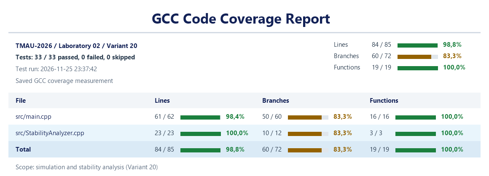

<p align="center">Министерство образования Республики Беларусь</p>
<p align="center">Учреждение образования</p>
<p align="center">«Брестский государственный технический университет»</p>
<p align="center">Кафедра ИИТ</p>

<br><br><br><br><br>

<p align="center">Лабораторная работа №2</p>
<p align="center">По дисциплине «Теория и моделирование автоматического управления»</p>
<p align="center">Тема: «Модульное тестирование и анализ устойчивости»</p>

<br><br><br><br><br>

<p align="right">Выполнил:</p>
<p align="right">Студент 3 курса</p>
<p align="right">Группы АС-68</p>
<p align="right">Цветков А. А.</p>
<p align="right">Проверил:</p>
<p align="right">Дворанинович Д. А.</p>

<br><br><br><br><br>

<p align="center">Брест 2026</p>

---

## Вариант 20

Моделирование и модульное тестирование моделей **1.10**, **2.4** и **3.8**. Программа сохраняет результаты в `results.csv` со столбцами `tau,u,y` и строит график через Matplotlib.

## Математические модели

| Модель | Уравнение шага |
| --- | --- |
| 1.10. Модель с распределённым окном управления | $y_{\tau+1} = a_1 y_\tau + b_1 u_\tau + b_2 u_{\tau-2}$ |
| 2.4. Логарифмическое взаимодействие переменных | $y_{\tau+1} = a y_\tau \cdot \cos(y_\tau) + b \ln(1 + \lvert u_\tau \rvert)$ |
| 3.8. Комбинированное линейно-квадратичное затухание | $\dfrac{dy}{dt} = -a_1 y - a_2 y^2 + b u$ |

Для **модели 1.10** принято $u_\tau = 0$ при $\tau < 0$. Вклад отложенного управления $b_2 u_{\tau-2}$ начинает действовать начиная с шага $\tau = 2$ (влияя на состояние $y_3$).

Для **модели 2.4** при нулевом состоянии и нулевом входе ($y_0 = 0, u_\tau = 0$) система находится в состоянии покоя ($y_{\tau+1} = 0$). Логарифмический член симметричен относительно знака входного сигнала за счёт модуля $\lvert u_\tau \rvert$.

Для **модели 3.8** используется явный метод Эйлера:
$$y_{\tau+1} = y_\tau + \Delta t \left(-a_1 y_\tau - a_2 y_\tau^2 + b u_\tau\right)$$
Для проверки сходимости при автономном движении ($u(t) = 0$) используется аналитическое решение уравнения Бернулли:
$$y(t) = \frac{a_1 y_0}{(a_1 + a_2 y_0) e^{a_1 t} - a_2 y_0} \quad (a_1 \neq 0)$$
При уменьшении шага интегрирования $\Delta t$ вдвое глобальная ошибка метода Эйлера первого порядка точности уменьшается примерно в 2 раза.

## Проверка устойчивости модели 1.10

При отключённом внешнем воздействии ($u_\tau = 0$) уравнение свободного движения имеет вид $y_{\tau+1} = a_1 y_\tau$. Подстановка $y_\tau = z^\tau$ даёт характеристическое уравнение $z - a_1 = 0$ с главным полюсом $z = a_1$ (дополнительные сдвиги по входу $u_{\tau-2}$ добавляют два собственных значения в нуле $z = 0$).

| Условие | Свободный отклик |
| --- | --- |
| $\lvert a_1 \rvert < 1$ | Затухает. Система асимптотически устойчива. |
| $a_1 = 1$ | Остаётся постоянным (граница устойчивости). |
| $a_1 = -1$ | Чередует знак при постоянном модуле (граница устойчивости). |
| $\lvert a_1 \rvert > 1$ | Расходится по модулю при ненулевом начальном состоянии. |

До запуска симуляции анализатор `StabilityAnalyzer` выводит предупреждение для граничного случая $\lvert a_1 \rvert = 1$ и для неустойчивого случая $\lvert a_1 \rvert > 1$, после чего расчёт продолжается.

## Запуск в Windows

Запустите командный файл из каталога `trunk/as06819/task_02`:

```bat
run_tests.bat
run_tests.bat --coverage
```

* При обычном запуске `run_tests.bat` компилирует библиотеку моделей, консольное приложение `task02.exe` и набор модульных тестов Google Test, прогоняет `ctest` и формирует графический отчёт `test_results.png`.
* При запуске с ключом `--coverage` дополнительно выполняется сбор покрытия с помощью `gcovr` и генерация HTML-отчёта `coverage.html`.

## Структура лабораторной

| Путь | Содержимое |
| --- | --- |
| `src/main.cpp` | Реализация моделей 1.10, 2.4, 3.8 и консольного приложения |
| `src/StabilityAnalyzer.cpp` | Анализатор устойчивости модели 1.10 и генерация предупреждений |
| `src/StabilityAnalyzer.h` | Заголовочный файл базового класса `Model`, наследников и анализатора |
| `test/test_models.cpp` | Параметризованные тесты траекторий моделей, инвариантов покоя и сходимости Эйлера |
| `test/test_signals.cpp` | Тесты ступенчатого, импульсного и гармонического входных сигналов |
| `test/test_stability.cpp` | Тесты полюсов на Z-плоскости, границы устойчивости и предупреждений |
| `doc/` | Отчёт по лабораторной работе и скриншот результатов `test_results.png` |
| `run_tests.bat` | Скрипт автоматической сборки, запуска тестов и генерации отчёта |

## Тестовое покрытие и результаты

Параметризованные тесты (`TEST_P`) проверяют расчёт шагов симуляции по заранее вычисленным контрольным точкам, состояние покоя при нулевых входах и начальных условиях, симметрию нелинейности, а также уменьшение глобальной ошибки метода Эйлера при дроблении шага.

* **Способ запуска:** Локальный скрипт (`run_tests.bat` / `run_tests.bat --coverage`)
* **Всего модульных тестов:** 33 (включая параметризованные наборы `Variant20`)
* **Успешно пройденных тестов:** 33 / 33

| Модуль / Класс | Покрытие строк (Line Coverage) | Покрытие функций (Func Coverage) | Статус |
| --- | :---: | :---: | :---: |
| `src/main.cpp` | 98.4 % (61/62) | 100 % (16/16) | OK |
| `src/StabilityAnalyzer.cpp` | 100 % (23/23) | 100 % (3/3) | OK |
| **Итоговый результат** | **98.8 % (84/85)** | **100 % (19/19)** | **Success** |


