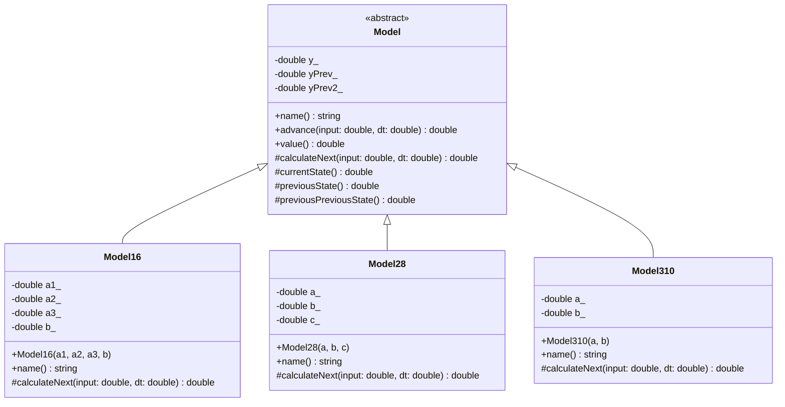
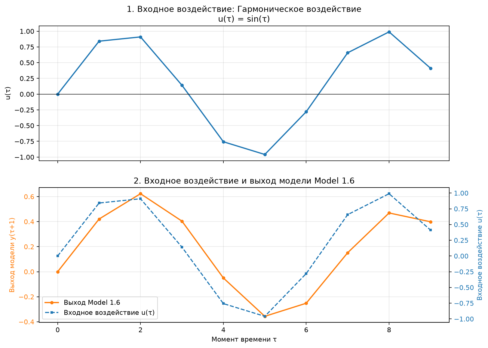

<p align="center">Министерство образования Республики Беларусь</p>
<p align="center">Учреждение образования</p>
<p align="center"><strong>«Брестский государственный технический университет»</strong></p>
<p align="center">Кафедра ИИТ</p>

<br><br><br><br>

<p align="center"><strong>Лабораторная работа №1</strong></p>
<p align="center">По дисциплине «Теория и моделирование автоматического управления»</p>
<p align="center">Тема: «Моделирование объектов управления»</p>

<br><br><br>

<p align="right">Выполнил:</p>
<p align="right">Студент 3 курса</p>
<p align="right">Группы АС-68</p>
<p align="right">Ярмолинский И. В.</p>
<p align="right">Проверил:</p>
<p align="right">Дворанинович Д. А.</p>

<br><br><br><br>

<p align="center">Брест 2026</p>

---

# Вариант 6

- Линейная модель: **Model 1.6 — динамическая система третьего порядка**.
- Нелинейная модель: **Model 2.8 — возмущение логистического отображения с хаотической динамикой**.
- Дифференциальное уравнение: **Model 3.10 — базовая модель с постоянным внешним смещением**.

## 1. Цель работы

Разработать программу на языке C++ для моделирования поведения объекта управления с использованием линейной, нелинейной и дифференциальной математических моделей.

Программа должна обеспечивать выбор математической модели и входного воздействия, ввод коэффициентов, настройку количества шагов симуляции, вывод результатов в табличном виде, экспорт данных в CSV и визуализацию входного сигнала и выхода системы.

## 2. Используемые технологии

- **C++17** — реализация математических моделей.
- **Объектно-ориентированное программирование** — абстрактный базовый класс и классы-наследники.
- **CMake** — конфигурация и сборка проекта.
- **Batch (`.bat`)** — автоматизация сборки и запуска программы.
- **Python 3 и Matplotlib** — визуализация результатов.
- **CSV** — сохранение расчётных данных.

## 3. Структура проекта

```text
task_01/
├── src/
│   ├── main.cpp
│   ├── ObjectModel.h
│   ├── charts.py
│   ├── CMakeLists.txt
│   └── build.bat
└── doc/
    ├── readme.md
    ├── module_1.6_step.png
    ├── module_1.6_impulse.png
    ├── module_1.6_harmonic.png
    ├── module_2.8_step.png
    ├── module_2.8_impulse.png
    ├── module_2.8_harmonic.png
    ├── module_3.10_step.png
    ├── module_3.10_impulse.png
    └── module_3.10_harmonic.png
```

### Назначение файлов

- `main.cpp` — ввод параметров, выбор модели и воздействия, выполнение симуляции, вывод таблицы и сохранение результатов.
- `ObjectModel.h` — абстрактный класс `Model` и реализации трёх математических моделей.
- `charts.py` — построение графиков по результатам симуляции.
- `CMakeLists.txt` — описание конфигурации сборки C++-программы.
- `build.bat` — автоматический запуск сборки, симуляции и визуализации.
- `readme.md` — отчёт о лабораторной работе.

## 4. Реализованные математические модели

В соответствии с вариантом 6 реализованы три модели.

### 4.1. Model 1.6 — линейная динамическая система третьего порядка

Математическое уравнение:

$$
y_{\tau+1}
=
a_1y_\tau
+a_2y_{\tau-1}
+a_3y_{\tau-2}
+bu_\tau.
$$

Где:

- $y_\tau$ — текущее значение выхода системы;
- $y_{\tau-1}$ и $y_{\tau-2}$ — предыдущие значения выхода;
- $u_\tau$ — входное управляющее воздействие;
- $a_1$, $a_2$, $a_3$ и $b$ — коэффициенты модели.

Модель учитывает текущее состояние и два предыдущих значения выходной переменной. Такое представление позволяет исследовать влияние истории состояния на динамику объекта управления.

Все коэффициенты вводятся пользователем перед началом симуляции.

### 4.2. Model 2.8 — нелинейная логистическая модель

Математическое уравнение:

$$
y_{\tau+1}
=
ay_\tau(1-y_\tau)
+bu_\tau
+c\sin(y_{\tau-1}u_\tau).
$$

Где:

- $y_\tau$ — текущее значение выхода;
- $y_{\tau-1}$ — предыдущее значение выхода;
- $u_\tau$ — входное воздействие;
- $a$, $b$ и $c$ — коэффициенты модели.

Логистическое слагаемое $ay_\tau(1-y_\tau)$ создаёт нелинейную зависимость выхода от текущего состояния. Слагаемое $c\sin(y_{\tau-1}u_\tau)$ учитывает взаимодействие предыдущего состояния с входным сигналом.

Поведение модели зависит от выбранных коэффициентов. В зависимости от параметров возможны ограниченные изменения выхода, колебания или расходимость расчётного процесса.

### 4.3. Model 3.10 — базовая модель с постоянным внешним смещением

Исходное дифференциальное уравнение:

$$
\frac{dy}{dt}=-ay+b+u.
$$

Для численного решения применяется метод Эйлера с шагом интегрирования $\Delta t$:

$$
y_{\tau+1}
=
y_\tau
+\Delta t(-ay_\tau+b+u_\tau).
$$

Где:

- $y_\tau$ — текущее значение выхода;
- $u_\tau$ — входное управляющее воздействие;
- $a$ и $b$ — коэффициенты модели;
- $\Delta t$ — шаг интегрирования.

В программе используется шаг интегрирования $\Delta t=0.1$.

Метод Эйлера позволяет последовательно вычислять новое значение выхода, используя предыдущее состояние и правую часть дифференциального уравнения.

## 5. Входные управляющие воздействия

Для проверки математических моделей предусмотрено три типа входных воздействий.

### 5.1. Ступенчатое воздействие

$$
u_\tau=1.
$$

На каждом шаге симуляции входное воздействие сохраняет постоянное значение, равное единице.

Такой сигнал используется для изучения реакции системы на постоянное управляющее воздействие и анализа переходного процесса.

### 5.2. Импульсное воздействие

$$
u_0=1,
\qquad
u_\tau=0 \quad \text{при } \tau>0.
$$

На первом шаге подаётся единичный импульс. На последующих шагах входное воздействие равно нулю.

Этот режим позволяет исследовать поведение модели после кратковременного внешнего воздействия.

### 5.3. Гармоническое воздействие

$$
u_\tau=\sin(\tau).
$$

Входной сигнал изменяется по синусоидальному закону. В программе вычисляются дискретные значения для $\tau=0,1,\ldots,n-1$; аргумент синуса задаётся в радианах.

График входного воздействия должен отражать последовательность значений $\sin(\tau)$. Выход системы при этом может отличаться от входной синусоиды из-за динамики выбранной модели.

## 6. Объектно-ориентированная архитектура

Программа построена на принципах объектно-ориентированного программирования.

Абстрактный базовый класс `Model` определяет общий интерфейс математических моделей. Конкретные уравнения реализованы в классах-наследниках:

- `Model16` — линейная модель 1.6;
- `Model28` — нелинейная модель 2.8;
- `Model310` — дифференциальная модель 3.10.

Базовый класс содержит текущее состояние системы и два предыдущих значения выхода. Эти данные находятся в секции `private`. Для доступа к состояниям из классов-наследников предусмотрены защищённые методы.

Метод `advance()` выполняет расчёт следующего состояния, проверяет корректность полученного значения и обновляет историю состояний. Виртуальный метод `calculateNext()` определяет вычисление следующего значения в конкретной модели.

Общий интерфейс позволяет основной программе работать с выбранной моделью через указатель на базовый класс `Model`. Это демонстрирует использование наследования и полиморфизма.

## 7. UML-диаграмма классов



На диаграмме представлены базовый абстрактный класс `Model` и три класса-наследника. Стрелки показывают наследование, а обозначения видимости членов соответствуют синтаксису UML:

- `+` — публичный член класса;
- `-` — закрытый член класса;
- `#` — защищённый член класса;
- `<<abstract>>` — абстрактный класс.

В программе также используются специальные типы исключений `ModelCalculationError`, `InputError` и `CsvOutputError` для обработки ошибок расчёта, пользовательского ввода и записи CSV.

Исходник диаграммы также хранится в `class_diagram.puml`.

## 8. Порядок работы программы

Запуск осуществляется с помощью `build.bat`.

Программа выполняет следующие действия:

1. Проверяет наличие CMake и настраивает проект.
2. Собирает программу C++.
3. Запрашивает количество шагов симуляции $n$.
4. Предлагает выбрать математическую модель.
5. Предлагает выбрать входное воздействие.
6. Запрашивает коэффициенты выбранной модели.
7. Выполняет расчёт и выводит таблицу результатов.
8. Сохраняет данные в CSV-файл.
9. Запускает скрипт Python для построения графиков.

Допустимое количество шагов моделирования — от 1 до 100000.

Для Model 1.6 вводятся $a_1$, $a_2$, $a_3$ и $b$. Для Model 2.8 вводятся $a$, $b$ и $c$. Для Model 3.10 вводятся $a$ и $b$.

В каждом запуске выбирается одна модель и один тип воздействия.

## 9. Формат выходных данных

Результаты симуляции сохраняются в файл `results.csv`.

| Столбец | Назначение |
|---|---|
| `signal` | Идентификатор входного воздействия |
| `step` | Номер шага моделирования |
| `tau` | Индекс входного сигнала |
| `time` | Время после шага |
| `u` | Значение входного воздействия |
| `model` | Название выбранной модели |
| `y` | Рассчитанное значение выхода |

CSV-файл используется скриптом `charts.py` для построения графиков.

## 10. Визуализация результатов

Скрипт `charts.py` строит одно изображение, содержащее два графика:

1. Верхний график — входное воздействие $u_\tau$.
2. Нижний график — выход выбранной модели $y_{\tau+1}$ и дополнительная линия входного сигнала для сравнения.

Для входного сигнала и выхода модели используются отдельные вертикальные шкалы, чтобы значения оставались различимыми даже при разных диапазонах.

Перед обработкой скрипт проверяет входной CSV-файл. В качестве аргумента допускается имя `results.csv`, расположенного внутри каталога проекта. Произвольные пути к файлам не принимаются.

Изображения сохраняются в каталог `doc`. Название файла содержит номер модели и идентификатор входного воздействия.

Например:

`module_2.8_harmonic.png`

Для полного набора результатов необходимо выполнить симуляцию для всех девяти сочетаний: трёх моделей и трёх типов воздействий.

### 10.1. Model 1.6 — линейная модель третьего порядка

#### Ступенчатое воздействие


#### Импульсное воздействие


#### Гармоническое воздействие



### 10.2. Model 2.8 — нелинейная логистическая модель

#### Ступенчатое воздействие


#### Импульсное воздействие


#### Гармоническое воздействие


### 10.3. Model 3.10 — дифференциальная модель

#### Ступенчатое воздействие


#### Импульсное воздействие


#### Гармоническое воздействие


## 11. Обработка ошибок

В программе предусмотрена обработка ошибок пользовательского ввода, вычислений и сохранения данных.

- `ModelCalculationError` используется при получении некорректного результата модели или недопустимого шага интегрирования.
- `InputError` используется при неправильном выборе модели, входного воздействия, количества шагов или некорректных коэффициентах.
- `CsvOutputError` используется при невозможности создать или записать CSV-файл.

Если математическая модель возвращает бесконечность или `NaN`, программа останавливает расчёт и выводит сообщение об ошибке. Это позволяет обнаруживать численную расходимость, а не продолжать вычисления с некорректными значениями.

## 12. Сборка и запуск

Для работы необходимы:

- CMake;
- компилятор C++17, например MSVC;
- Python 3;
- библиотека Matplotlib.

Поскольку `CMakeLists.txt` находится в каталоге `src`, для ручной сборки необходимо открыть терминал в этой папке и выполнить:

```powershell
cmake -S . -B build
cmake --build build --config Release
```

Для автоматической сборки и запуска предусмотрен `build.bat`. Скрипт выполняет конфигурацию CMake, сборку, запуск симуляции и вызов Python-скрипта. Если Matplotlib отсутствует, выполняется попытка автоматической установки библиотеки.

При необходимости Matplotlib можно установить вручную:

```powershell
python -m pip install matplotlib
```

## 13. Ограничения реализации

- Коэффициенты задаются пользователем, поэтому результаты зависят от выбранных параметров.
- Нелинейная модель 2.8 может расходиться при некоторых значениях коэффициентов.
- Программа проверяет корректность ввода и обнаруживает неконечные результаты вычислений.
- Дополнительное задание по аналитическому определению устойчивости и поиску корней характеристического уравнения не реализовано.

## 14. Вывод

В ходе лабораторной работы разработана программа на C++ для моделирования трёх математических моделей объекта управления: линейной системы третьего порядка, нелинейной логистической модели и дифференциального уравнения.

Реализованы объектно-ориентированная архитектура, выбор модели и входного воздействия, настройка количества шагов, ввод коэффициентов, табличный вывод результатов и сохранение данных в CSV.

Визуализация позволяет сравнивать входное воздействие и выход модели, исследовать переходные процессы и особенности поведения системы при ступенчатом, импульсном и гармоническом воздействиях.